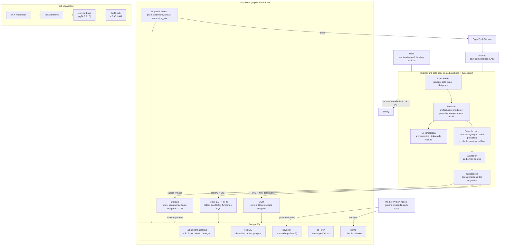
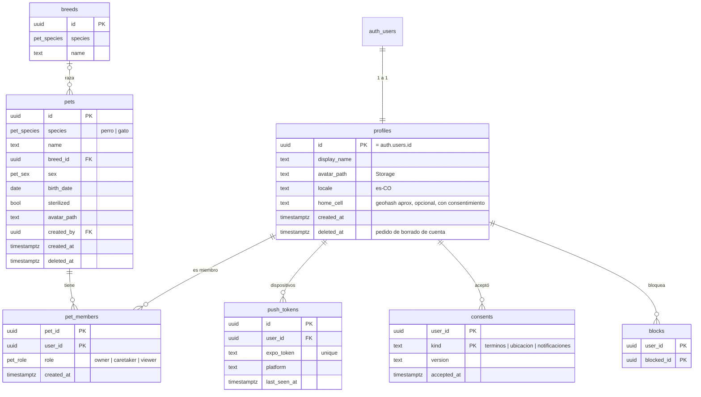
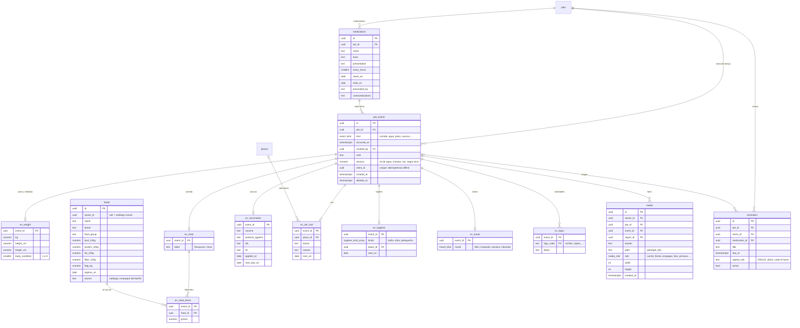
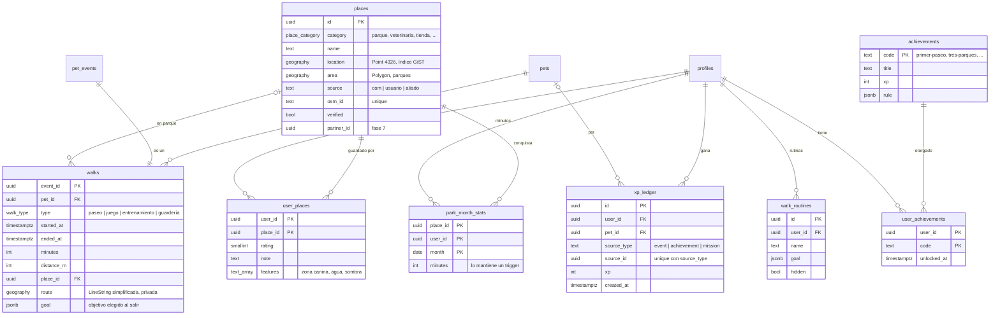
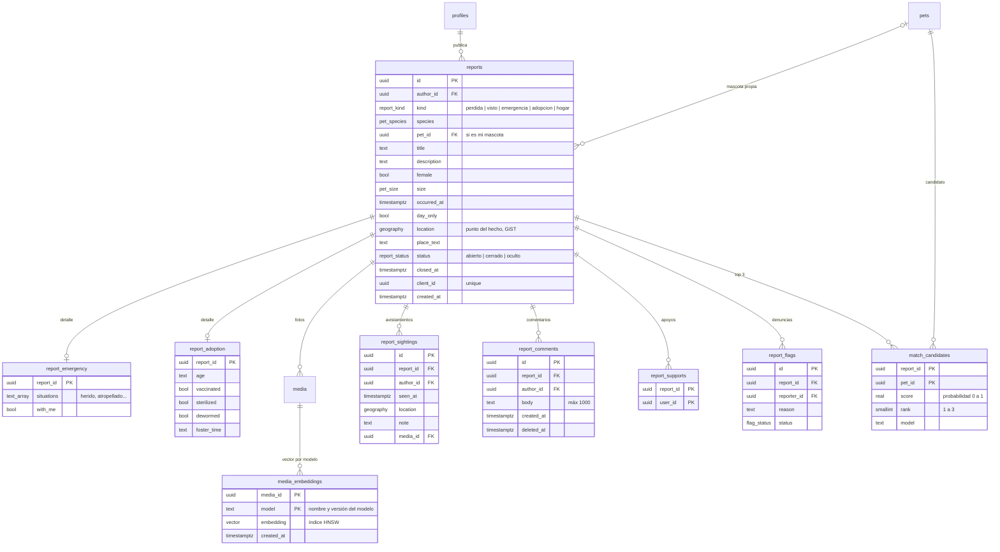

# Plan: del demo a código de producción

> Estado: **propuesta para aprobar**. Rama de trabajo: `dev-cristian`. Nada va a `main` hasta que Cristian lo decida.
> Fecha: 2026-10-23.

## 1. Contexto

El demo de Jim (`main`, 38 pantallas) es la **referencia funcional y visual**: qué hace la app y cómo se ve. No es la base técnica de producción. Su núcleo tiene límites que no escalan:

- **Un solo blob por usuario:** todo vive en `AppData`, un JSON con una sola mascota. Se sincroniza entero a `app_data.data` (`jsonb`) y gana la última escritura.
- **Registros sin esquema:** los 16 tipos de registro guardan sus datos en `fields: Record<string, string>`, incluso JSON metido en texto (`fields.menu`).
- **Lógica en el cliente:** XP, niveles, logros y conquista de parques se calculan en el teléfono (`src/lib/game.ts`, `src/lib/parks.ts`), así que se pueden falsear y no sirven para rankings.
- **Mapa sin geografía real:** es un barrio dibujado con coordenadas `x`/`y` en metros, sin GPS.
- **Comunidad a medias:** fotos solo locales, comentarios, apoyos y avistamientos solo en el teléfono, y vecinos de ejemplo.
- **Sin red de seguridad:** no hay tests, lint, CI ni manejo de errores (abundan los `.catch(() => {})`).

El objetivo es reconstruir la app **módulo por módulo y pantalla por pantalla**: código limpio, escalable, rápido y seguro, probado de verdad en web y en el celular en cada paso, con la arquitectura preparada para muchos usuarios aunque arranquemos con pocos.

## 2. Decisiones

### Tomadas por Cristian (2026-10-23)

| Tema | Decisión |
|---|---|
| Cuenta y conexión | **Cuenta obligatoria + caché offline.** Todo vive en Postgres. La app cachea lo leído y encola lo escrito sin señal. Se elimina "Seguir sin cuenta". |
| Builds | **Development build propio (EAS), solo Android por ahora.** Se deja Expo Go. |
| Interfaz | **Simplificar en el mismo paso, con spec previa** por pantalla, aprobada antes de codear. |
| Entornos | **Supabase local (Docker) + un proyecto cloud de dev.** Producción se crea al acercarse el lanzamiento. |

### Supuestos por defecto (se pueden cambiar en la revisión)

- **Backend:** se mantiene Supabase (Postgres + Auth + Storage). PostGIS, `pgvector`, `pg_cron` y `pgmq` se activan como extensiones. Python solo para el matching visual (fase 6).
- **SDK:** se vuelve a **Expo SDK 58**. Con un build propio ya no dependemos de Expo Go, y `main` está en 58.
- **`main` de Jim:** queda como demo congelado de referencia. Si Jim se suma, entra por el mismo flujo.
- **Login:** correo + contraseña en la fase 1, y Google después. Apple Sign-In cuando haya iPhone, porque la App Store lo exige si se ofrece Google.
- **Idioma y país:** español de Colombia (`es-CO`) desde el día uno, con textos fuera del código (i18n) para sumar países e idiomas sin reescribir.
- **Mapas:** se decide en la spec del módulo de paseos (fase 3). Recomendación inicial: MapLibre con tiles basados en OpenStreetMap, el mismo mapa en web y Android y sin costo por uso. Alternativa: Google Maps.
- **Costos:** planes gratis durante el desarrollo (Supabase, EAS, Sentry). La sección 9 lista qué se paga y cuándo.
- **Datos de prueba:** siempre sintéticos (`supabase/seed.sql`), como dice `CLAUDE.md`.

## 3. Arquitectura



**Reglas de arquitectura**

1. **El cliente nunca confía en sí mismo.** Toda regla que importe (permisos, XP, logros, cierre de reportes) vive en Postgres: RLS, constraints, funciones SQL o triggers. El cliente solo muestra y pide.
2. **Escrituras de varias tablas = una función RPC** (transacción atómica). Ejemplo: registrar un paseo inserta `pet_events` + `walks` + `xp_ledger` en una sola llamada.
3. **Escrituras idempotentes:** cada escritura lleva un `client_id` (UUID generado en el teléfono) con `unique`. Si la cola offline reenvía algo, no se duplica.
4. **`service_role` solo en Edge Functions y workers**, nunca en la app.
5. **Tipos generados** (`supabase gen types`) + validación con zod en formularios y respuestas. Ningún `any`.
6. **Una sola forma de hacer cada cosa:** misma estructura en todas las features (sección 5), mismo patrón de queries y mutaciones, mismos componentes de UI.

## 4. Modelo de datos

Principios:
- **IDs:** `uuid` en todas las tablas.
- **Columnas comunes:** `created_at` y `updated_at` por trigger. `deleted_at` (borrado lógico) donde el usuario puede deshacer.
- **Tipos cerrados:** enums de Postgres (`pet_species`, `event_kind`, `report_kind`, etc.). Las listas que crecen (razas, lugares, alimentos, logros) son tablas catálogo.
- **Mascota con varios humanos:** `pet_members` permite familia, paseador o cuidador desde el día uno, aunque la UI muestre una sola mascota.
- **Expediente:** `pet_events` es la línea de tiempo (lo común a todo registro), y cada tipo con datos propios tiene su tabla de detalle 1:1. Se reemplaza el `Record<string,string>` por columnas tipadas, consultables e indexables.
- **Privacidad por diseño:**
  - La casa del dueño nunca se guarda exacta, solo una celda aproximada (`home_cell`, geohash de unos 1,2 km) y solo con consentimiento.
  - Las rutas de paseo son privadas y se recortan al inicio y al final.

### 4.1 Identidad y mascotas



### 4.2 Expediente vivo



### 4.3 Lugares, paseos y gamificación



### 4.4 Comunidad y Recuperación



**Qué pasa con el demo:** `app_data` y el blob se descartan. No hay usuarios reales que migrar (todos los datos son de prueba). La tabla `reports` actual se reemplaza por la nueva.

### 4.5 Seguridad de datos (RLS)

- **RLS activado en todas las tablas, con denegar por defecto.** Cada política se escribe a propósito y se prueba con pgTAP: "A no puede leer la mascota de B", "un `viewer` no puede escribir", etc.
- **Funciones auxiliares `security definer stable`**, como `is_pet_member(pet_id, min_role)`, para no repetir subconsultas en cada política y que el planner las optimice.
- **Storage:** rutas `pets/{pet_id}/…` y `reports/{report_id}/…` con políticas que reusan esas funciones. Las subidas se hacen con URL firmada, y antes de subir la imagen se comprime en el teléfono y se le borran los metadatos EXIF (incluido el GPS).
- **Datos públicos con una vista o RPC explícita:** los reportes de otros se leen con `reports_near(lat, lng, radio_m)`, que devuelve solo campos públicos y un alias del autor, nunca su `user_id` ni su correo.
- **Límites de abuso:**
  - En la base: `check` de longitud, un máximo de reportes abiertos por usuario y un rate limit por función (con una tabla de conteo por ventana).
  - En Auth: CAPTCHA en el registro.
- **Ley 1581 (Colombia, habeas data) y requisitos de las tiendas:**
  - Consentimiento versionado (`consents`).
  - Exportar mis datos.
  - Borrar mi cuenta desde la app (obligatorio en Google Play y App Store).
  - Política de privacidad publicada.

## 5. Estructura del código

```
src/
  app/                      rutas de Expo Router: archivos delgados que montan pantallas de features
  features/
    auth/  pets/  timeline/  health/  nutrition/  body/  walks/  places/
    gamification/  community/  recovery/  settings/
      api.ts                queries y mutaciones (TanStack Query) contra supabase
      schemas.ts            zod: formularios y respuestas
      hooks.ts              hooks de la feature
      components/           componentes propios de la feature
      screens/              pantallas (las rutas de src/app las importan)
      __tests__/
  shared/
    ui/                     botones, campos, tarjetas, listas: construidos sobre tokens
    theme/                  tokens (colores, tipografía, espacios) migrados de src/lib/theme.ts
    i18n/                   textos es-CO
    lib/                    supabase client, query client, offline queue, logger, fechas
    types/database.ts       generado: supabase gen types
supabase/
  migrations/               una migración por cambio, nunca se editan las ya aplicadas
  tests/                    pgTAP: RLS y funciones
  seed.sql                  datos sintéticos
  functions/                Edge Functions (push, borrado de cuenta)
docs/
  plan-produccion.md        este documento
  decisiones/               un archivo por decisión (ADR): qué, por qué, alternativas
```

**Patrones fijos**
- **Lectura:** `useQuery` con claves por feature (`['pets', petId, 'events']`), paginación por cursor (`occurred_at`, `id`) y nunca `offset`.
- **Escritura:** `useMutation` con actualización optimista, rollback si falla y un error visible para el usuario (se terminan los `.catch(() => {})`). Las mutaciones quedan en pausa sin red y se reanudan solas.
- **Estado de UI local** (un formulario a medio llenar, el paseo en curso) con `useState` o un store chico. Lo que viene del servidor no se duplica en contextos globales.
- **Listas largas** con FlashList, imágenes con `expo-image` (caché en disco) y miniaturas de Storage.
- **Rendimiento:** las pantallas se cargan solas por ruta, se mide el tamaño del bundle web y no se hacen cálculos pesados en el render (van a la base o se memoizan).

## 6. Flujo de trabajo por pantalla (Definition of Done)

Cada pantalla o módulo pasa por estos pasos, en este orden:

1. **Spec (antes de escribir código, la aprueba Cristian).** Qué se ve, qué se quita, qué se pospone, qué datos lee y escribe, estados vacío, cargando, error y sin red, y textos.
2. **Migración + RLS + tests pgTAP**, si la pantalla necesita tablas nuevas. Se prueba en local con `supabase db reset`.
3. **Capa de datos de la feature:** `api.ts` y `schemas.ts`, con tests unitarios.
4. **Pantalla y componentes** con UI compartida y textos en i18n.
5. **Verificación real**, sin la cual no está hecha:
   - Web en el navegador (`npx expo start --web`).
   - Android con el development build, contra la base local por Wi-Fi.
   - El mismo flujo contra el proyecto cloud de dev.
   - Prueba sin red: modo avión, registrar algo, volver a conectar y comprobar que subió una sola vez.
6. **CI en verde:** lint, typecheck, tests y pgTAP.
7. **Commit en `dev-cristian`** con mensaje descriptivo. Si hubo una decisión de diseño, va con su ADR en `docs/decisiones/`.

Mientras dura la migración, las pantallas del demo que aún no pasaron siguen funcionando con el store viejo (`src/lib/store.tsx`). Cada módulo migrado lo reemplaza, y al final se borran `store.tsx`, `cloud.ts` y el blob.

## 7. Fases

Orden según la arquitectura de producto (Expediente → Comunidad → Recuperación). Cada fase termina con algo usable en web y Android.

### Fase 0: Cimientos (sin features nuevas)
- **Herramientas:** ESLint (config de Expo), Prettier, `tsconfig` estricto con alias `@/`, Jest + React Native Testing Library, y scripts `lint`, `test` y `db:test`.
- **SDK y builds:** volver a SDK 58. Agregar `expo-dev-client`, `eas.json` con perfiles `development`, `preview` y `production`, y el primer development build Android instalado en tu celular.
- **Base de datos:**
  - Docker Desktop + Supabase CLI, y `supabase init` y `start`.
  - Proyecto cloud de dev en región São Paulo, con la organización a nombre de la cuenta del proyecto.
  - Primera migración con extensiones y helpers (`set_updated_at`, `is_pet_member`) y el `seed.sql` sintético.
- **Configuración por entorno** con variables `EXPO_PUBLIC_*` (`.env.local` ignorado y EAS env para los builds). Se borra `cloudConfig.ts`.
- **Capa compartida:** cliente Supabase tipado, QueryClient con caché persistida y cola offline, logger y Sentry (sin PII).
- **UI e i18n:** tokens de diseño a partir de `src/lib/theme.ts`, una primera tanda de componentes de `shared/ui` e i18n con `es-CO`.
- **CI:** GitHub Actions con lint, typecheck, tests, `supabase db start` + pgTAP y el export web.
- **Documentación:** `docs/arquitectura.md` y `docs/base-de-datos.md` (los diagramas de este plan, mantenidos al día).
- **Limpieza:** borrar `App.tsx` y `basio.html`, y revisar `AGENTS.md` y `.claude/settings.json` con Cristian antes de decidir si quedan.

**Listo cuando:** la app vacía con la nueva estructura abre en web y en el build Android, y la CI está en verde.

### Fase 1: Identidad
| Pantalla del demo | Qué se hace |
|---|---|
| `entrar` | Login y registro con correo, recuperar contraseña y verificación de correo. Se quita "Seguir sin cuenta". |
| `crear-mascota` | Crea `pets` + `pet_members(owner)` en un RPC, con avatar a Storage. |
| `perfil`, `ajustes` | Perfil, nombre visible, cerrar sesión, **borrar cuenta** (Edge Function) y consentimientos. |
| `(tabs)/_layout` | Guarda de rutas: sin sesión va a `entrar`, sin mascota va a `crear-mascota`. |

**Tablas:** `profiles`, `pets`, `pet_members`, `breeds`, `consents`.

### Fase 2: Expediente vivo
| Pantalla del demo | Qué se hace |
|---|---|
| `(tabs)/mascota` | Línea de tiempo paginada (`pet_events`) con filtros. Hoy tiene 773 líneas, así que se parte en componentes. |
| `registro` (botón +) | Menú de registro rápido. |
| `ficha` (vacuna, medicamento, alimento) | Formularios tipados con zod, fotos del carnet o el empaque a Storage y vista previa. |
| `veterinario` | Citas con lugar del catálogo `places`. |
| `comida` | Menú con `ev_meal_items` y balance del día calculado en SQL (vista o RPC). |
| `medidas`, `foto-semana`, `higiene`, `animo`, `novedad` | Detalles tipados por tipo. |
| Recordatorios | Tabla `reminders` + notificaciones locales programadas desde el build propio. Toda recomendación de salud lleva el aviso "no es diagnóstico veterinario". |

**Tablas:** `pet_events` y detalles, `foods`, `medications`, `reminders` y `media`.

### Fase 3: Paseos y lugares
- **Decisión de proveedor de mapas** (ADR).
- **Carga de parques reales** de OpenStreetMap para Bogotá en `places`.
| Pantalla del demo | Qué se hace |
|---|---|
| `(tabs)/index` (Inicio) | Mapa real con tu ubicación y parques cercanos (`places_near`). |
| `paseo`, `salida` | Paseo con GPS: cronómetro, distancia y ruta simplificada. Funciona sin señal y se sube al terminar. |
| `paseos`, `resumen`, `recurrentes` | Historial, estadísticas (agregados en SQL) y rutinas. |
| `parques`, `parque`, `lugares`, `explorar` | Catálogo de lugares, guardados, calificaciones y filtros por categoría. |

### Fase 4: Gamificación en el servidor
- XP por triggers o RPC en `xp_ledger`, sin duplicados gracias al `unique(source_type, source_id)`.
- Niveles calculados en SQL.
- Logros evaluados en el servidor. Se reusan las reglas de `src/lib/game.ts` como especificación.
- Conquista mensual de parques con `park_month_stats` mantenida por trigger, y cierre de mes con `pg_cron`.
- Misión diaria.
- Pantallas: `logros` y el modal de celebración, que llega por respuesta del RPC.

### Fase 5: Comunidad
| Pantalla del demo | Qué se hace |
|---|---|
| `perdidas` | Lista y mapa con `reports_near` (PostGIS `ST_DWithin`) y radio de 1 a 100 km. |
| `reportar`, `nuevo-reporte`, `emergencia`, `adopcion` | Los 5 tipos con detalles tipados, fotos y ubicación del hecho. |
| `reporte` | Comentarios, apoyos, avistamientos y cerrar reporte, todo en la nube. Incluye denunciar y bloquear. |
| `vecino`, `reencuentros` | Perfil público mínimo (alias, cifras e insignias) e historias reales. |
| Avisos | Push a dueños con `home_cell` dentro del radio: un trigger encola en `pgmq` y una Edge Function envía en lotes. |
| `(tabs)/comunidad` | Tabla del barrio con datos reales (vista agregada por celda), y los desafíos después. |

### Fase 6: Recuperación (match visual)
- Worker Python que lee la cola, genera embeddings de las fotos de mascotas y reportes, y los guarda en `media_embeddings` con índice HNSW.
- RPC `match_report(report_id)` que devuelve **siempre el top 3 con probabilidad**, nunca una certeza.
- Se evalúa con datasets de licencia compatible y fotos sintéticas o de prueba.

### Fase 7: Aliados y monetización
- Veterinarias y tiendas aliadas (`places.partner_id`) y promos segmentadas a partir del expediente, con consentimiento.
- Sin campañas reales ni APIs de Meta: todo mockeado mientras sea demo.

### Fase 8: Preparación de lanzamiento
- **Infraestructura:** proyecto de producción separado, Supabase Pro (sin pausas y con backups diarios), PITR si el volumen lo justifica, y alertas.
- **Pruebas:** de carga sobre las RPC críticas (`reports_near`, la línea de tiempo) con datos sintéticos a escala.
- **Publicación:** ficha de Play Store, política de privacidad, términos y canal de soporte.

## 8. Escalabilidad: qué queda preparado desde el día uno y qué se activa después

| Preparado desde el inicio | Se activa cuando haga falta |
|---|---|
| Índices compuestos (`pet_id, occurred_at desc`), GiST en geografía, paginación por cursor | Particionar `pet_events` y `walks` por mes (ya con decenas de millones de filas) |
| Lógica en SQL y RPC (pocas idas y vueltas) | Réplicas de lectura de Supabase para las consultas de comunidad |
| Cola `pgmq` para trabajos lentos (push, embeddings) | Más workers en paralelo |
| Agregados (rankings, conquista) mantenidos por trigger o `pg_cron` | Vistas materializadas con refresco programado |
| Imágenes con transformación y CDN de Storage | CDN propio si el egreso crece |
| Pooling de conexiones (Supavisor) para Edge Functions y workers | Subir el plan de cómputo de Supabase |
| Celdas geográficas (`home_cell`) para repartir avisos | Repartir avisos por región en paralelo |
| Sentry con rendimiento | Analítica de producto (PostHog) con consentimiento |

## 9. Costos

- **Desarrollo:** USD 0. Planes gratis de Supabase (dos proyectos activos; uno es el de dev), EAS (builds Android con cola gratuita), Sentry y GitHub Actions. Docker Desktop es gratis para uso personal.
- **Al lanzar:** Supabase Pro (aprox. USD 25/mes), cuenta de Google Play (USD 25, pago único), dominio y hosting web (gratis o bajo costo), y Apple Developer (USD 99/año) solo cuando se sume iPhone.
- **Los precios hay que verificarlos al momento de pagar;** estos son de referencia.

## 10. Riesgos

| Riesgo | Mitigación |
|---|---|
| Alcance enorme (38 pantallas) | Spec por pantalla y simplificación. Cada fase entrega algo usable. Se puede cortar después de cualquier fase. |
| Docker en Windows Home (WSL2) | Si da problemas, se trabaja contra el proyecto cloud de dev y la CI sigue probando la base en local. |
| Divergencia con `main` de Jim | `main` queda congelado como referencia. Los cambios de Jim se leen como spec, no se mergean. |
| GPS y batería en paseos | Precisión adaptable y ruta simplificada antes de subir. Seguimiento en segundo plano solo durante un paseo activo y con permiso explícito. |
| Privacidad de ubicación | `home_cell` aproximado, rutas privadas y recortadas, y RPC públicas que nunca exponen `user_id`. |

## 11. Verificación global

- **CI en cada push a `dev-cristian`:** lint, typecheck, tests unitarios, pgTAP (RLS de todas las tablas) y export web.
- **En cada fase:** recorrido manual en web y Android (base local y cloud), una prueba sin red y una revisión de seguridad de la migración. La pregunta es: "¿qué puede leer o escribir otro usuario?".
- **Antes de lanzar:** prueba de carga con datos sintéticos a escala (por ejemplo, 1 millón de eventos y 100.000 reportes) midiendo los tiempos de las RPC críticas.
